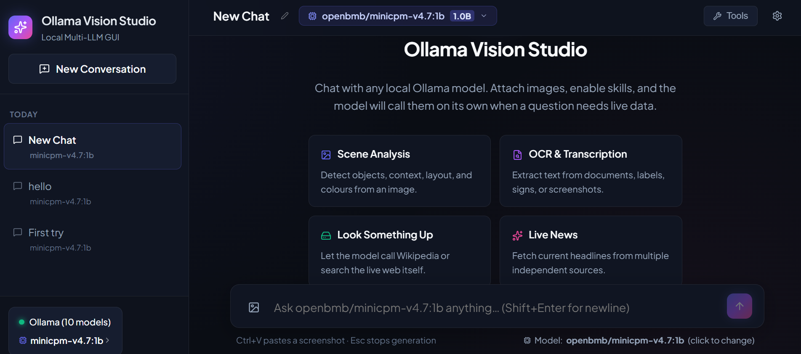
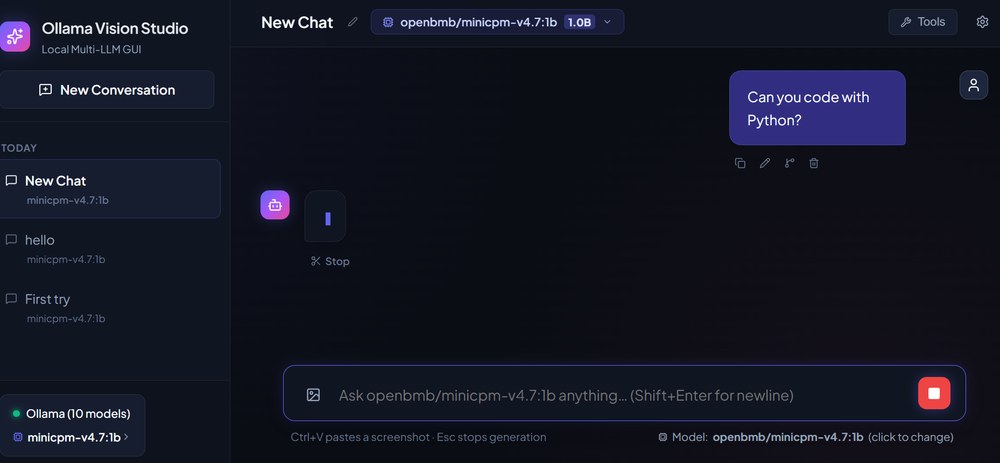
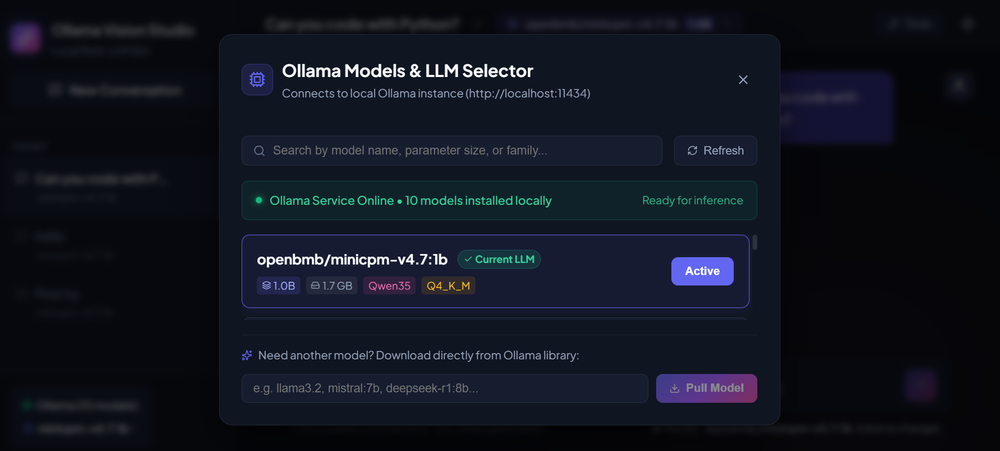
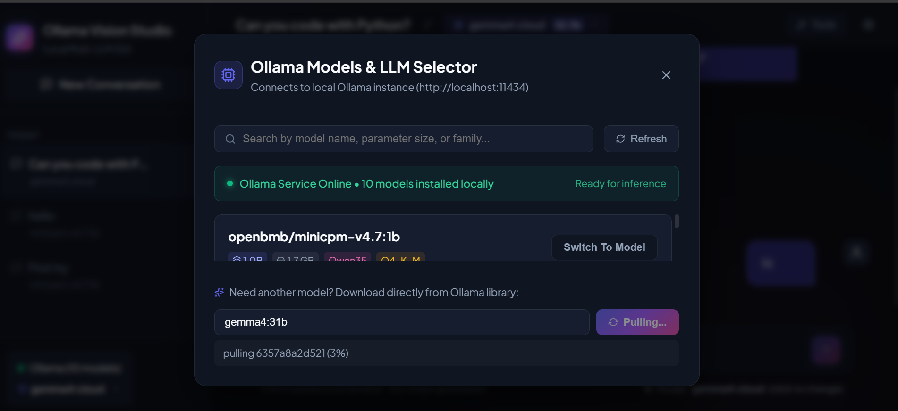
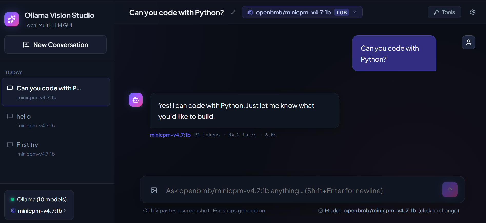
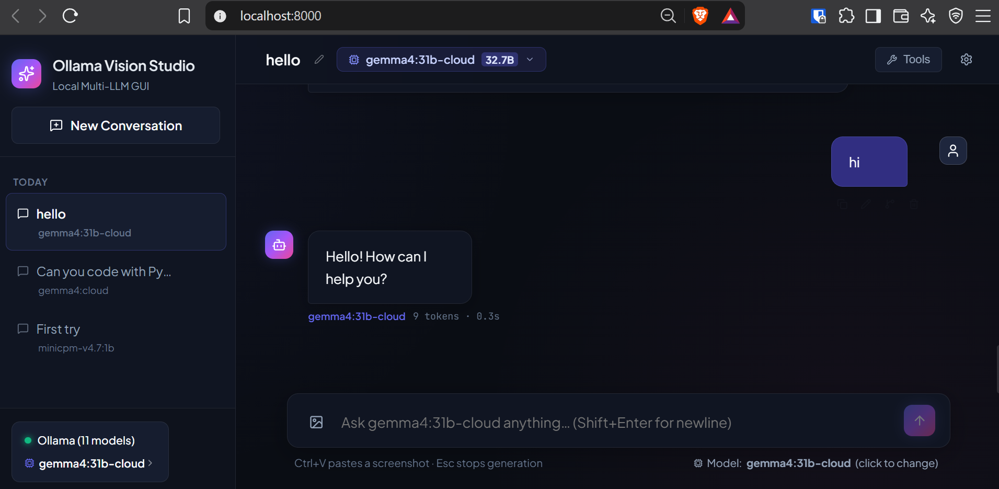

# Ollama Vision Studio

A local-first desktop GUI for chatting with **any** [Ollama](https://ollama.com)
model — local or cloud.

Pull models without leaving the app, attach images and ask questions about them,
let the model call tools like a web search or calculator on its own, and keep
every conversation on disk with full edit history.

Everything runs on your machine. Nothing is sent anywhere except to the services
you explicitly enable (Ollama, and whichever tools are switched on).

---

## Quick Start

**First time?** Double-click `setup.bat`. It creates the Python virtualenv,
installs dependencies, and installs the frontend packages.

Then double-click:

| Launcher | URL | Use for |
|---|---|---|
| `start.bat` | http://localhost:8000 | Normal use |
| `start-dev.bat` | http://localhost:5173 | Developing (hot reload) |

Requires **Python 3.11+** and **Node.js** already installed, plus
[Ollama](https://ollama.com/download) running (`ollama serve`).



*New chats open on a welcome screen with suggested prompts, and the sidebar keeps every conversation.*

---

## What the GUI can do

### Conversations

- **Create** chats from the sidebar; rename any of them inline by clicking the title
- **Auto-titles** from your first message, then upgraded into a real title by the model
- **Search** your chats by title or model
- **Pin** important chats to the top
- **Grouped by recency** — Today / Yesterday / Previous 7 days / Older
- **Delete** a chat and everything in it
- **Branch** from any message to fork a new chat that inherits the history up to that point
- **Export** any chat to **Markdown** or **JSON** (includes model, tool calls and stats)
- Everything is stored in SQLite on your machine and survives restarts

### Sending and editing messages

Hover any message to reveal its actions:

| Action | Applies to | What happens |
|---|---|---|
| **Copy** | any | Copies the message text to the clipboard |
| **Edit & resend** | your messages | Rewrites it, deletes everything after it, re-asks the model |
| **Delete** | any | Removes that single message |
| **Branch** | your messages | Forks a new chat from that point |
| **Regenerate** | latest reply | Re-runs the model on the same prompt |

- **Stop** generation at any time with the stop button or `Esc` — whatever was
  already written is **saved**, and marked `incomplete` rather than thrown away
- **Per-reply statistics**: token count, tokens/sec and total latency
- Replies render with **markdown**, **GFM tables** and **syntax-highlighted code**
- Click the model pill under the composer to **switch model instantly**



*The send button turns red while the model is writing, and hovering any message reveals its actions.*

### Images and vision

- Attach images by **file picker**, **drag-and-drop**, or **`Ctrl+V`** to paste a screenshot
- **Multiple images per message** (up to 8) — good for before/after comparisons
- Images are **downscaled in your browser** before upload (max edge 1568px), so a
  12-megapixel photo does not become a 50MB upload
- Identical images are stored once, not repeatedly
- Vision models receive the images directly, so you can just ask what is in them

### Models — local and cloud

- **Every installed model in one dropdown**, searchable by name, family or size
- **Pull new models from inside the GUI** — type a name like `qwen3.5:4b`, watch
  the download progress, and switch to it the moment it lands
- **Switch between local and cloud models freely.** Cloud models
  (`gemma4:31b-cloud`, `deepseek-v4-flash:cloud`, …) sit in the same list as local ones
- **Per-conversation model binding** — each chat remembers the model it uses
- Size, parameter count, quantisation and family shown for every model before you switch
- Refresh on demand if you pull something from a terminal



*Every installed model in one searchable list, with size, family and quantisation shown before you switch.*



*Download progress is shown in place — switch to the new model the moment it lands.*



*Per-reply statistics show tokens, tokens/sec and latency for the model that answered.*

### Tools the model can call

Switch tools on in the **Tools** modal. They are advertised to the model, which
decides for itself when to use them — you never have to ask explicitly.

| Tool | Default | What it does |
|---|---|---|
| `grokipedia` | on | Article summaries from grokipedia.com, the open-source knowledge base |
| `web_search` | on | Live news and web results from multiple sources |
| `fetch_url` | on | Reads an actual web page and returns its text |
| `calculator` | off | Exact arithmetic, trigonometry, roots — no guessing |
| `image_metadata` | off | Dimensions, format, EXIF, GPS presence |
| `system_info` | off | Host OS/CPU and Ollama status |
| `filesystem` | off | Sandboxed, read-only search and file reading |

`grokipedia`, `web_search` and `fetch_url` are on out of the box — those three
and nothing else, so a new install can look things up, search the live web
and read a page right away. Switch any of them off in the **Tools** modal
and the choice is remembered; every other tool is opt-in.

While it works you see a live **"Using tools…"** strip; afterwards the reply keeps a
collapsible **"Used N tools"** panel listing each call, its arguments, its result
and how long it took. Every skill also has a **Run standalone test** button, and
you can **add your own** by dropping a Python file into `backend/skills/`.

### Per-conversation settings

Open the gear icon in the header:

- **System prompt** — fully editable, with presets (General / Concise / Coding /
  Vision Analyst / Translator)
- **Tool calling mode** — Auto (probe once, then cache), Always, or Never
- **Parameters** — temperature, top_p, context window, max reply tokens, seed,
  with Precise / Balanced / Creative / Deterministic presets
- **Connection** — remote Ollama host and API key (see [Cloud models](#cloud-models-cloud))
- **Export** — download the chat

### Keyboard

| Key | Action |
|---|---|
| `Enter` | Send message |
| `Shift+Enter` | Newline |
| `Esc` | Stop generation (when the composer is empty) |

---

## Cloud models (`:cloud`)

Ollama cloud models such as `gemma4:31b-cloud`, `gemma4:cloud` and
`deepseek-v4-flash:cloud` run on Ollama's servers.



*Cloud and local models appear in the same list and the same sidebar — each conversation remembers the one it used.*

**You almost certainly do not need an API key here.** The local Ollama daemon
already authenticates with the account you signed into, so once you have run:

```
ollama signin
```

in a terminal, cloud models just work.

Use **Settings → Connection** only if you need to:

- point at a **remote Ollama host** rather than `localhost:11434`, or
- use a **different account** than the one `ollama signin` stored.

The key is written to `backend/data/settings.json` (gitignored), sent only to
your configured host, and is never returned to the browser — the UI only learns
whether a key is present and its last four characters. **Test** verifies it
honestly: it lists models *and* runs a one-token generation against a cloud
model, because an already-signed-in local daemon will happily list models with
a bogus key and report success.

If one cloud model returns a billing error, that model is not in your plan —
the others still work.

### One thing that trips people up

`num_predict: -1` means "unlimited" to a local model, but Ollama Cloud is
proxied through an OpenAI-compatible backend that requires a **positive**
`max_tokens` and rejects the request with:

```
max_tokens must be positive, got: -1
```

The app strips non-positive `num_predict` before sending, so unlimited replies
work on both. If you ever see that error, a stale value is stored on that
conversation — clear it in Settings → Parameters.

---

## Tool calling and small models

Tool calling needs model support. The app **probes each model once**, caches the
result on disk (so a restart does not probe again), and falls back to plain chat
when unsupported. You can override in Settings → System prompt:

- **Auto** — probe once, then cache *(default)*
- **Always** — send tools even if the probe failed
- **Never** — never offer tools

Greetings and other small talk never need a tool, so they skip the probe and go
straight to the model. A tool call is only made when the request actually needs
live data.

Five guards keep small models from stalling:

1. **Name recovery.** Models often invent qualified names like `grokipedia.search`
   or `calc`. The registry maps those back to the real skill instead of failing
   the turn.
2. **Forgiving call parsing.** Models that cannot call tools natively write the
   call as text, and they write it badly: the closing tag is often wrong
   (`</query>` instead of `</function>`) or missing, and the argument is often
   plain text rather than a tagged parameter. The parser accepts all of that.
3. **Repeat detection.** If the model re-issues the same call, the cached result
   is reused rather than paid for twice.
4. **Forced final answer.** After two repeats — or two failures — tools are
   withheld and any further call is refused, so the model must answer in prose.
5. **Last-resort summarisation.** If the loop ends with no text at all, one final
   tool-free pass runs with an explicit "answer now" instruction, so you get an
   answer instead of silence.

Whatever the model writes, the raw call syntax is retracted from the chat as
soon as it is recognised — you never see the XML, only the tool and the answer.

---

## Writing your own skill

Drop a `BaseSkill` subclass into `backend/skills/`. It is discovered on startup
and shows up in the Tools modal immediately.

```python
from typing import Any, Dict, Optional
from backend.skills.base import BaseSkill, SkillContext


class UnitConverterSkill(BaseSkill):
    name: str = "unit_converter"
    display_name: str = "Unit Converter"
    description: str = (
        "Convert between units of length, mass or temperature. "
        "Call this for any 'X in Y' conversion."
    )
    enabled_by_default: bool = True
    parameters: Dict[str, Any] = {
        "type": "object",
        "properties": {
            "value": {"type": "number", "description": "The value to convert."},
            "from_unit": {"type": "string", "description": "e.g. 'km'"},
            "to_unit": {"type": "string", "description": "e.g. 'mi'"},
        },
        "required": ["value", "from_unit", "to_unit"],
    }

    async def execute(
        self, ctx: Optional[SkillContext] = None, **kwargs
    ) -> Dict[str, Any]:
        # ctx.image_paths holds this turn's uploads; ctx.last_user_prompt the prompt.
        return {"result": f"{kwargs['value']} {kwargs['from_unit']} ≈ ..."}
```

Notes:
- Return a dict. Include an `error` key to report failure to the model.
- Results are truncated to 4000 characters before entering the model context.
- Skills have a 30s timeout by default (`DEFAULT_SKILL_TIMEOUT`).
- Only `.py` modules are loaded; `base.py` and `__init__.py` are skipped, and
  subdirectories are ignored. Restart the server to pick up a new skill.
- `description` matters more than you would expect — it is the only thing the
  model sees when deciding whether to call your tool. Write it as an instruction
  to the model, not as a label for a human.

### Security

**Skills are arbitrary Python and run with your user account's permissions.**
Only enable tools you trust, and review anything you place in
`backend/skills/`. The `filesystem` skill is confined to `SKILLS_FS_ROOT`
(default `~/Documents`), rejects path traversal, and is read-only;
`image_metadata` can only read files the user actually uploaded.

Never use `eval()` on model-supplied input. The `calculator` skill shows the
safe alternative: parse with `ast` and allow-list the node types and names.

---

## Configuration

All optional, via environment variables:

| Variable | Default | Purpose |
|---|---|---|
| `OLLAMA_HOST` | `http://localhost:11434` | Ollama endpoint |
| `DEFAULT_MODEL` | `openbmb/minicpm-v4.7:1b` | Model for new chats |
| `MAX_TOOL_ITERATIONS` | `5` | Cap on agent loop rounds |
| `HISTORY_MESSAGES` | `10` | Messages replayed to the model |
| `IMAGE_HISTORY_TURNS` | `2` | Recent turns that keep their images |
| `MAX_UPLOAD_BYTES` | `10485760` | Upload size cap |
| `MAX_IMAGES_PER_MESSAGE` | `8` | Image cap per message |
| `UPLOAD_RETENTION_DAYS` | `30` | Age at which unreferenced uploads are swept |
| `SKILLS_FS_ROOT` | `~/Documents` | `filesystem` skill sandbox root |
| `APP_TOKEN` | *(unset)* | If set, all `/api` calls need `X-App-Token` |

---

## Security posture

This service can execute Python, so it is locked down by default:

- Binds to `127.0.0.1` only.
- **Rejects requests whose `Host` header is not localhost** — blocks DNS
  rebinding, where a malicious page resolves its own domain to 127.0.0.1 and
  then drives this API.
- CORS is a fixed localhost allowlist, never `*`.
- Uploads are validated by decoding the image, not by file extension, and are
  content-addressed so identical files are stored once.
- Unreferenced uploads are swept at startup.

Set `APP_TOKEN` for defence in depth if other local software or users share the
machine.

---

## Project layout

```
backend/
  main.py           HTTP routes
  chat.py           Agent loop: tool calling, context assembly, SSE events
  config.py         All tunables in one place
  ollama_client.py  Client auth + option sanitising for Ollama Cloud
  user_settings.py  Persisted preferences incl. the API key
  database.py       SQLite schema + migrations
  uploads.py        Upload validation, dedupe, GC
  skills/           Auto-discovered BaseSkill subclasses
frontend/
  src/lib/sse.ts    Shared SSE parser (handles split frames correctly)
  src/lib/api.ts    Typed API client
  src/components/   UI
```

---

## Troubleshooting

**"Ollama Offline"** — start it with `ollama serve`, or point `OLLAMA_HOST` at
your instance.

**Tools never fire** — the model may not support tool calling. Check Settings →
tool mode, or enable `system_info` and ask about your machine to confirm the
model will call tools at all.

**A cloud model returns 402** — that model is not included in your Ollama plan.
Other cloud models still work; pick one of those.

**A cloud model errors about `max_tokens`** — see the note in
[Cloud models](#cloud-models-cloud).

**Upload rejected** — only real, decodable images under the size cap. Renaming a
file to `.png` does not make it one.

**Port 8000 busy** — the launchers stop the previous process automatically.